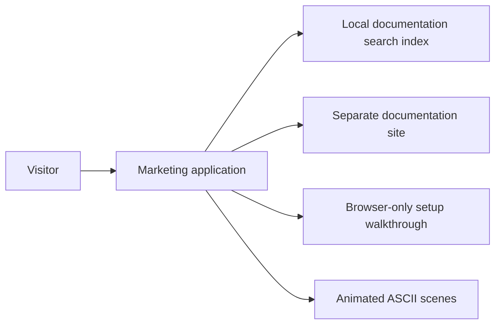

# Architecture

Both sites use Next.js, React, Tailwind, Radix, motion, and next-themes. They
share navigation and theme primitives while retaining independent deployments.

## Source map

| Source | Responsibility |
| --- | --- |
| `components/marketing-content.tsx` | Sections, copy, and page links |
| `components/setup-panel.jsx` | Platform commands and clipboard feedback |
| `components/setup-lab.jsx` | Animated walkthrough and manual controls |
| `lib/setup-data.js` | Example profiles, commands, and transcripts |
| `styles/marketing.css` | Page layout |
| `styles/marketing-theme.css` | Semantic theme colors and contrast |
| `content-data/search.json` | Standalone snapshot of documentation search |

## Shared source

`shared-ui.json` records shared docs UI files; `upstream.json` records the
original component revision and file hashes. CI checks both. Run
`python3 scripts/sync-docs-ui.py` only after intentional docs UI changes, then
review the files and manifest together. CI does not require a sibling checkout.

After product documentation changes, run `python3 search_index.py` from
`website/` with the docs checkout available, then copy `site/docs-search.json`
to `content-data/search.json` and review the diff.
