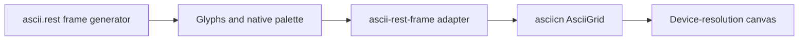

# Artwork and themes

The Redwood Light hero uses the native asciicn scene. Ember and Black Hole use
its shader renderer. The footer's Jungle falls, Misty forest, and Alpine dawn
use original ascii.rest frame generators through an asciicn grid bridge.

## Preserve scene quality

Keep the native palette and source grid density. Forcing a smaller cell across
the same container duplicates source glyphs rather than adding detail. A denser
scene needs a higher-resolution generator. Landscapes cover their container;
logos and the blueprint tree use contain sizing.

The grid engine handles visibility, reduced motion, resizing, and animation
cleanup. Check every scene on desktop and mobile, in both themes. Keep text
scrims separate from the artwork so improving readability does not recolor it.

## Branding and licensing

Global tokens live in `styles/set-me-up.css`; marketing adaptations belong in
`styles/marketing-theme.css`. Keep syntax colors and selected controls readable
against their own surfaces. The theme tests verify the shared contrast pairs.

Original component notices remain in `ASCIICN-LICENSE` and
`vendor/ascii-rest/LICENSE`. They remain applicable to those sources alongside
the project's [license](../LICENSE).
