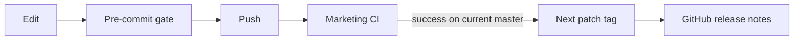

# Delivery and maintenance

## One validation gate

CI and the pre-commit hook run `bun run ci` from `website/` in the Flox
environment. The gate includes source lint, Markdown lint, Mermaid parsing,
authored-file LOC budgets, upstream/shared UI integrity, TypeScript, tests,
and a production build. Workflow syntax is checked with actionlint.

From the root repository, install hooks with
`pre-commit install`. Hooks validate complete files, not only changed lines;
CI runs the same commands without relying on hooks being installed.

## LOC budgets

`scripts/check-quality.ts loc` enforces limits stored in `scripts/loc-budgets.json`.
The default is 300 lines per authored file. Existing page composition and CSS
have explicit limits matching their current size. Vendored upstream files,
lockfiles, generated search data, and migration output are excluded.

Prefer removing duplication and splitting cohesive responsibilities before
increasing a limit. New exclusions require a clear provenance or generated
source explanation, not a way around the budget.

## Releases

A successful Marketing CI push on `master` triggers the release workflow.
Only its validated SHA can be tagged, and it must still be the current branch
head. Tags increment the latest stable patch version, starting at `v0.1.0`.
Reruns reuse an existing tag and release. Pull requests and failed runs never
publish releases. No personal token is required.

A GitHub release records the source revision; Vercel remains responsible for
hosting the Next.js application. Check both CI and the deployment status when
shipping a visual change.
